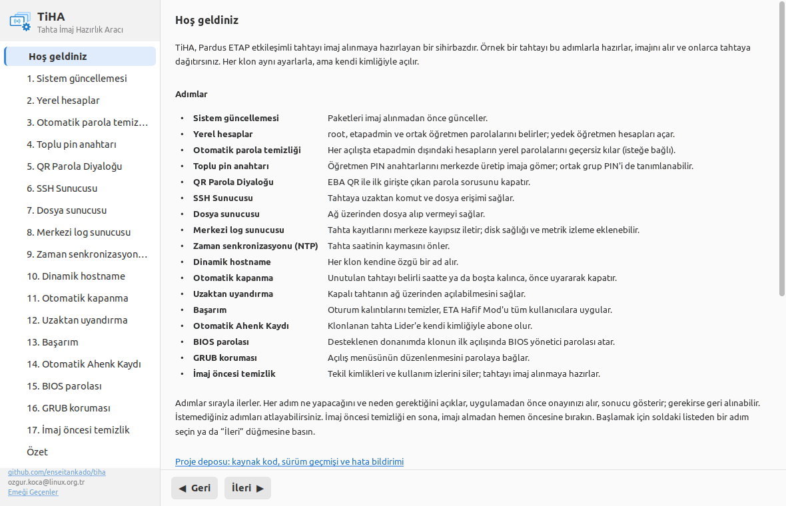
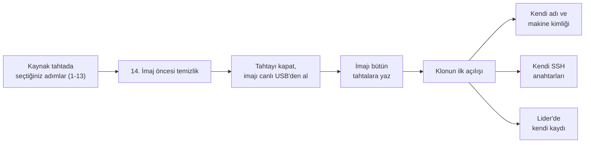
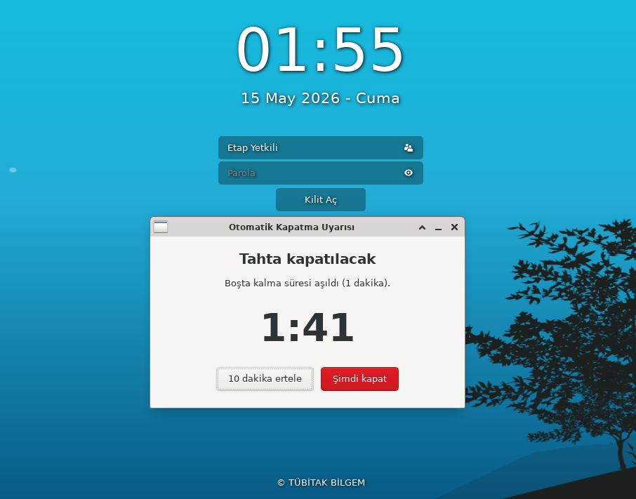

# TiHA: Tahta İmaj Hazırlık Aracı

Pardus ETAP 23 yüklü bir etkileşimli tahtayı imaj almaya hazırlayan sihirbaz. Bir tahtayı TiHA ile hazırlarsınız, imajını alırsınız ve o imajı okuldaki bütün tahtalara yazarsınız. İmajdan çıkan her tahta ilk açılışında kendi adını, makine kimliğini, SSH anahtarlarını ve Lider kaydını alır.

   

<a href="docs/images/00-hosgeldiniz.png"></a>

## Çalıştırma

1. Tahtada **Etap Yönetici** (`etapadmin`) hesabıyla oturum açın.
2. Uygulamalar menüsünden **Terminal**'i açın.
3. Aşağıdaki komutu yapıştırıp **Enter**'a basın:

```bash
curl -fsSL https://raw.githubusercontent.com/enseitankado/tiha/main/bootstrap.sh | bash
```

Komut, etapadmin parolanızı bir kez sorabilir ve sihirbazı açar. TiHA tahtaya kurulmaz: her çalıştırmada güncel sürüm geçici bir klasöre indirilir.

## İş akışı



Sihirbaz her adımda ne yapacağını anlatır, onayınızı alır ve sonucu gösterir. Adımların çoğu geri alınabilir. Son sayfadaki rapor, imaja neyin girdiğini ve klon tahtada neyin denenmesi gerektiğini listeler.

## Adımlar

| # | Adım | Ne yapar |
|---|------|----------|
| 1 | Sistem güncellemesi | Paketleri günceller, eksik Pardus depo satırlarını ekler. |
| 2 | Yerel hesaplar | root, etapadmin ve ortak öğretmen parolalarını koyar; yedek ve branş hesaplarını açar. |
| 3 | PIN anahtarları | Öğretmenlerin 6 haneli PIN'le girişi için anahtar ve QR kodlu kâğıt üretir. |
| 4 | SSH & Samba | Uzaktan terminal ve dosya erişimini açar. |
| 5 | Merkezi log sunucusu | Kayıtları okul sunucusuna gönderir; sunucuya ulaşılamazsa ntfy ile haber verebilir. |
| 6 | Zaman senkronizasyonu (NTP) | Saati doğru tutar; PIN kodları saate bağlıdır. |
| 7 | Dinamik hostname | Her klona ağ kartı adresinden üretilen ayrı bir ad verir. |
| 8 | Otomatik kapanma | Unutulan tahtayı belirli saatte ya da kullanılmayınca geri sayımla kapatır. |
| 9 | Uzaktan uyandırma | Kapalı tahtanın ağ üzerinden açılmasını hazırlar (Wake on LAN). |
| 10 | Başarım | Oturum kalıntılarını temizler, isteğe bağlı ETA Hafif Mod uygular. |
| 11 | Ahenk | Klonların Lider'e kendi kimlikleriyle kaydolmasını sağlar. |
| 12 | BIOS parolası | Desteklenen modellerde klonun BIOS'una ilk açılışta parola koyar. |
| 13 | GRUB koruması | Açılış menüsünü düzenlemeyi ve kurtarma kipini parolaya bağlar. |
| 14 | İmaj öncesi temizlik | Kimlikleri sıfırlar, izleri siler, tahtayı imaja hazırlar. Geri alınamaz. |

Her adımın ayrıntısı ve uyarıları [kullanım kılavuzunda](docs/kilavuz.md#adımlar).

8. adımın kapanma uyarısı, kimse oturum açmamışken giriş ekranında da görünür. Geri sayımı kullanıcı "10 dakika ertele" ile durdurabilir:

<a href="docs/images/bonus-greeter-countdown.png"></a>

## Başlamadan önce

- İmaj öncesi temizliği en sona bırakın; ondan sonra uygulanan her adım temizliğin tekrarını gerektirir.
- Burada koyduğunuz parolalar imajdaki her tahtada aynı olur.
- İmajı yaymadan önce en az bir klon tahtada deneyin.
- Öğretmenin kişisel hesabı ilk EBA QR girişinde oluşur; PIN ile giriş bundan sonra çalışır.

Gerekçeleri [kılavuzun "Baştan bilmeniz gerekenler" bölümünde](docs/kilavuz.md#baştan-bilmeniz-gerekenler).

## Komut satırı

Sihirbazı açmadan tek bir adımı uygulamak için seçenekleri `bash -s --` ardından yazın. Örnek, 4. adımda SSH'yi açıp Samba'yı kapatır:

```bash
curl -fsSL https://raw.githubusercontent.com/enseitankado/tiha/main/bootstrap.sh | bash -s -- -u 4 -d enable_ssh=evet -d enable_samba=hayir
```

`-h` bütün seçenekleri gösterir. Ayrıntı [kılavuzda](docs/kilavuz.md#komut-satırından-kullanım); yönetim sunucusundan (ör. [Ankamon](https://github.com/enseitankado/ankamon)) kullanım [makine arayüzü belgesinde](docs/makine-arayuzu.md).

## Belgeler

| Belge | İçerik |
|-------|--------|
| [Kullanım kılavuzu](docs/kilavuz.md) | Adımların ayrıntısı, uyarılar, komut satırı, ağ düzeni, ekran görüntüleri, hata raporları |
| [Özet raporu](docs/ozet-raporu.md) | Son sayfadaki raporun bölümleri ve kontrol listesi |
| [Makine arayüzü](docs/makine-arayuzu.md) | `--sema` ve `--json` ile TiHA'yı başka bir programdan kullanma |
| [Başarım](docs/m17-basarim-deneysel.md) | 10. adımın mekanizması ve ölçümleri |
| [Ahenk](docs/m12-clone-reclaim.md) | Klonların Lider'e yeniden kaydolma akışı |
| [Otomatik kapanma](docs/m11-eta-shutdown-bypass.md) | 8. adımın eta-shutdown ile ilişkisi |

## Hata raporları

Beklenmeyen bir hatada TiHA geliştiriciye anonim, kısa bir rapor gönderir; ad, parola, adres ve günlük içermez. Kapatmak için tahtada `sudo touch /etc/tiha/hata-raporu-kapali` çalıştırın. Raporun içeriği [kılavuzda](docs/kilavuz.md#hata-raporları).

## Katkı ve destek

Hata bildirimi ve öneriler için [Issues](https://github.com/enseitankado/tiha/issues), sorular için [Discussions](https://github.com/enseitankado/tiha/discussions). Pull request kuralları [`CONTRIBUTING.md`](CONTRIBUTING.md) dosyasında.

PIN adımı [eta-otp-cli](https://github.com/enseitankado/eta-otp-cli), BIOS adımı [eta-112](https://github.com/enseitankado/eta-112) aracını kullanır. Öteki bağımlılıklar sihirbazdaki **Emeği Geçenler** penceresinde lisanslarıyla listelenir.

## Lisans

GPL-3.0, ayrıntı [`LICENSE`](LICENSE) dosyasında. Copyright © 2026 Özgür Koca.
